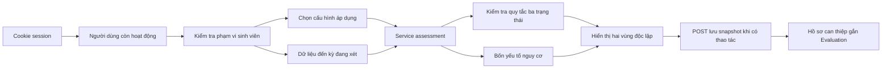
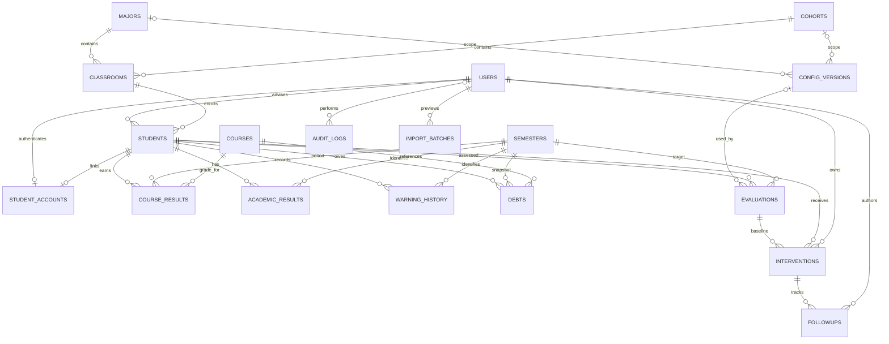

# Kiến trúc và thiết kế

## Phạm vi

EduAlert là ứng dụng monolith chạy local. FastAPI phục vụ cả HTML render Jinja2, JSON API và static assets cùng origin. SQLite giữ dữ liệu qua lần khởi động. Không có worker, hàng đợi hoặc phụ thuộc dịch vụ đám mây lúc chạy.

## Chín giao diện quản lý và cổng sinh viên

| # | Giao diện | Nội dung |
|---|---|---|
| 1 | Đăng nhập | Xác thực và lỗi đăng nhập; không hiển thị thành viên nhóm |
| 2 | Dashboard | Bộ lọc, số lượng, phân bố, diễn biến, ưu tiên hỗ trợ |
| 3 | Sinh viên | Tìm, lọc, sắp xếp, phân trang 12 dòng, xuất đúng bộ lọc |
| 4 | Hồ sơ | 5 tab: tổng quan, học tập, giải thích, can thiệp, mô phỏng |
| 5 | CSV | Tải 4 mẫu, xem trước, lỗi, xác nhận giao dịch |
| 6 | Cấu hình | Nháp bất biến, xem trước ảnh hưởng, kích hoạt phiên bản |
| 7 | Can thiệp | Danh sách / bảng 4 trạng thái, lịch hẹn, ghi chú, sửa thật |
| 8 | Báo cáo | Theo lớp/ngành/khóa/kỳ, thiếu dữ liệu, can thiệp, CSV và in |
| 9 | Quản trị | Tab sinh viên/phân công, tài khoản cố vấn, danh mục |

Tab, form, thông báo lỗi không tạo giao diện chính mới. `/docs` là tài liệu kỹ thuật FastAPI; trang lỗi không tính là nghiệp vụ thứ mười.

Theo phạm vi mở rộng, sinh viên có cổng riêng gồm6trang: tổng quan, kết quả, phân tích, kế hoạch, cố vấn/lịch hẹn và hồ sơ. Mỗi trang có URL riêng và render phía máy chủ; `/dashboard` chuyển sinh viên tới `/student/overview`. Xem [student-portal.md](student-portal.md). Admin/cố vấn tiếp tục dùng các trang quản lý bên trên.

## Cấu trúc

```text
app/
  main.py                 # FastAPI, session, CSRF, login/logout, lỗi
  db.py                   # engine/session, SQLite FK
  models.py               # SQLAlchemy, ràng buộc dữ liệu
  schemas.py              # Pydantic input
  security.py             # Argon2, xác thực và kiểm tra phân công
  seed.py                 # dữ liệu giả lập, idempotent
  demo_data.py            # dữ liệu học tập thuần Python dùng chung seed/test
  routers/pages.py        # đúng 9 giao diện Jinja2
  routers/student.py      # 6 trang cá nhân, API /api/me, POST HTML dự phòng
  routers/api.py          # JSON, CSV, quản trị
  services/assessment.py  # tính toán thuần Python, dùng chung mô phỏng
  services/data.py        # chọn cấu hình, snapshot, scope/filter thống nhất
  services/csv_import.py  # kiểm tra và ghi CSV
  templates/              # app, login, thông báo lỗi
static/portal.css, portal.js # khối quản lý và helper API dùng chung
static/student.css, student.js, login.css
static/vendor/             # Chart.js sau bước cài, có license và SRI
migrations/                # Alembic 0001 + 0002, schema lịch sử đóng băng
tests/                     # thuật toán + integration/API
samples/, docs/, scripts/
legacy/                    # lưu mã MVP để đối chiếu, không phục vụ runtime
```

Các router dùng SQLAlchemy trực tiếp cho CRUD đơn giản; không thêm repository/interface cho từng bảng. Service chỉ tách nơi có nghiệp vụ dùng chung. Giao diện quản lý render shell/form rồi gọi API; cổng sinh viên render cả dữ liệu bằng Jinja, JavaScript bổ sung biểu đồ và tương tác. Không cần frontend build.

## Luồng đánh giá



GET chỉ tính/đọc, không tạo đánh giá. Nút lưu đánh giá hoặc tạo can thiệp dùng POST có CSRF. Seed tạo các đánh giá ban đầu khi chạy CLI. Mô phỏng chỉ gọi service thuần Python, không thêm bảng kết quả hoặc đánh giá.

## ERD



## Phân quyền, session và CSRF

- `current_user` tải người dùng từ DB trong mỗi request, tài khoản bị khóa không dùng được session cũ.
- `admin` chặn các thao tác quản trị/CSV/cấu hình/danh mục/kết quả học tập.
- `student_access` trả 404 khi ngoài phân công; áp dụng cho trang chi tiết, API, lưu đánh giá, mô phỏng, tạo/sửa can thiệp. Không dựa vào tham số advisor do client gửi.
- Danh sách, thống kê, báo cáo và CSV cùng gọi `filtered` bắt đầu từ `scoped_students`.
- Vai trò `student` dùng `own_student` và bảng liên kết tài khoản; mọi trang/API cá nhân lấy sinh viên từ session. Không được đọc API quản lý, danh sách toàn hệ thống hoặc ghi chú theo dõi nội bộ.
- Session ký bằng secret riêng. Cookie HttpOnly, SameSite=Lax, 8 giờ; Secure nếu HTTPS. Local tạo secret ngẫu nhiên vào tệp không đưa git; HTTPS yêu cầu biến môi trường dài ≥32 ký tự.
- Mọi POST/PUT/PATCH/DELETE, kể cả đăng nhập và đăng xuất, cần CSRF đối chiếu token session. Form HTML gửi hidden field; fetch gửi `X-CSRF-Token`.
- Argon2 mã hóa một chiều mật khẩu; không lưu plaintext. Thử đăng nhập giới hạn 10 lần/5 phút theo địa chỉ + username trong một process.
- Nhật ký không ghi mật khẩu/secret; ghi đăng nhập thành công, thay cấu hình, lưu đánh giá, nhập/xuất CSV và cập nhật nghiệp vụ.

## Nhất quán dữ liệu và phiên bản

SQLite bật foreign keys trên kết nối ứng dụng. Một kết quả học kỳ và một quyết định lịch sử cho mỗi sinh viên/kỳ. Một snapshot môn nợ cho mỗi sinh viên/kỳ/học phần. UI tính tổng môn/tín chỉ nợ từ các dòng `debts` nối `courses`, không giữ một cột tổng nợ thứ hai.

Chọn cấu hình ưu tiên: ngành+khóa → ngành → khóa → toàn cục. Phiên bản cùng phạm vi được ngừng kích hoạt trong cùng giao dịch trước khi kích hoạt bản mới; khóa ghi SQLite tránh hai thao tác kích hoạt/nhập đồng thời. Payload phiên bản không có API sửa; cần tạo nháp mới. Các evaluation đã lưu giữ ID cấu hình, input và output cũ. Biểu đồ tính theo cấu hình hiện hành được ghi nhãn; không ghi đè snapshot lịch sử.

Migration `0001` dùng metadata đóng băng tại `migrations/schema_v1.py`, không nhập model ứng dụng để làm thay đổi migration cũ khi phát triển tiếp. Thay schema sau này cần tạo revision mới, đọc kỹ migration sinh ra rồi kiểm thử trên bản sao DB.

## Giới hạn xác minh

Đã chạy migration/seed/server và61pytest,6test JavaScript ở bản3.1.0. Còn kiểm tra trực quan laptop/điện thoại, debugger F5 và cài trên máy sạch khác. Xem [testing.md](testing.md) và nhật ký thực tế.
